# Sahayak (सहायक)

**Voice-first health triage for ASHA community health workers, with a live dashboard for the PHC doctor.**

A worker speaks or types a patient's symptoms in **English, Hindi, Marathi or Bengali** and sees an urgency level (HIGH, MEDIUM, LOW, or "not confident") within seconds, even with no internet. Every result shows the exact words that caused it. A real-time dashboard shows each case to the doctor at the Primary Health Centre, who can send a note back to the worker's phone.

> **Not a medical device.** Sahayak is a screening aid built as a university project. It does not diagnose, and its rules have not been validated by clinicians.

| | |
|---|---|
| **Worker app (AWS S3)** | https://24215111-sahayak-triage-app.s3.us-east-1.amazonaws.com/index.html |
| **Doctor dashboard (AWS S3)** | https://24215111-sahayak-triage-app.s3.us-east-1.amazonaws.com/dashboard.html |
| **Worker app (live)** | https://sahayak-a-health-triage.web.app |
| **Doctor dashboard (live)** | https://sahayak-a-health-triage.web.app/dashboard |
| **Course** | BCA482-5, Specialization Project, Christ (Deemed to be University), Delhi NCR |
| **Guide** | Prof. Lata Yadav |

## Team

Arush Shahi, Aryama Sharma, Rajvansh S Kohli, Simran K Bora

## What it does

- **Speech or typing** in four languages. Voice uses the browser's Web Speech API; typing has live symptom detection and 11 tap-to-add chips per language.
- **On-device triage.** A rule engine with about 1,900 keywords (English, Hindi, Marathi, Bengali, romanised Hindi) runs in the browser, so triage works offline.
- **Vitals rules.** SpO2, temperature (°C, with automatic °F conversion) and age-banded pulse can raise urgency.
- **Offline-first.** Cases are saved on the phone first and synced to Firebase when a network is available.
- **Doctor dashboard.** Live counters, seven-day and per-village charts, HIGH alerts, a case drawer, and doctor notes that appear on the worker's phone.
- **Referral slip** with WhatsApp sharing, history, search, and CSV/JSON export.

## Screenshots

### Worker app

| | | | |
|:--:|:--:|:--:|:--:|
| 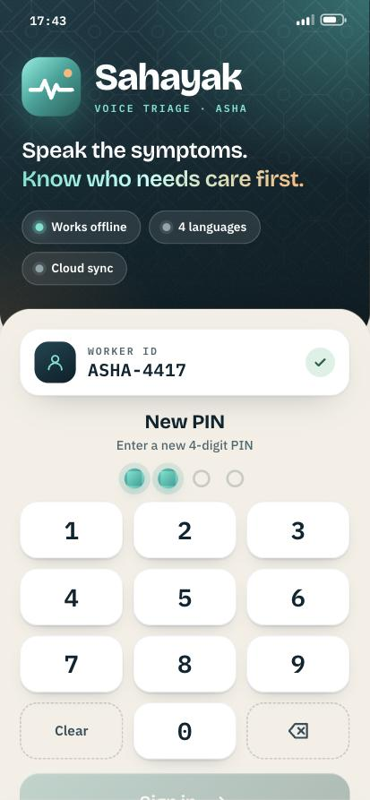<br>PIN sign-in | 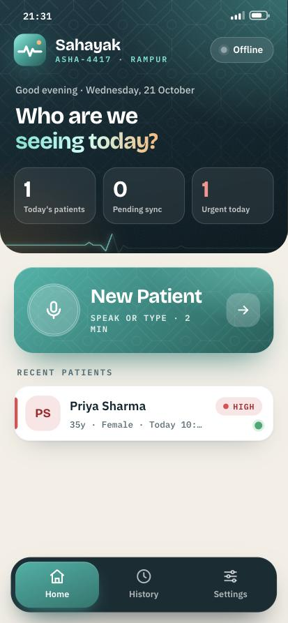<br>Home | 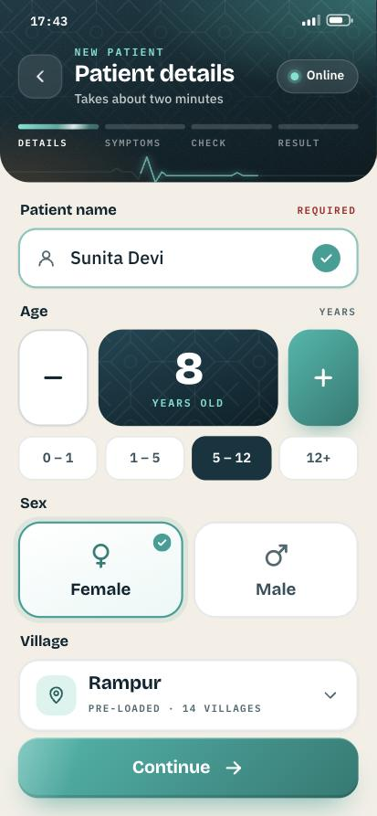<br>Patient details | 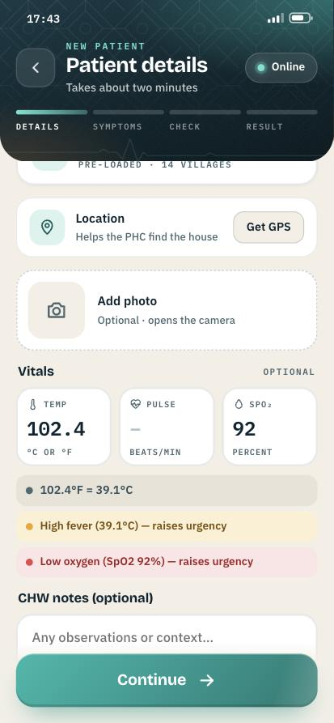<br>Vitals with live flags |
| 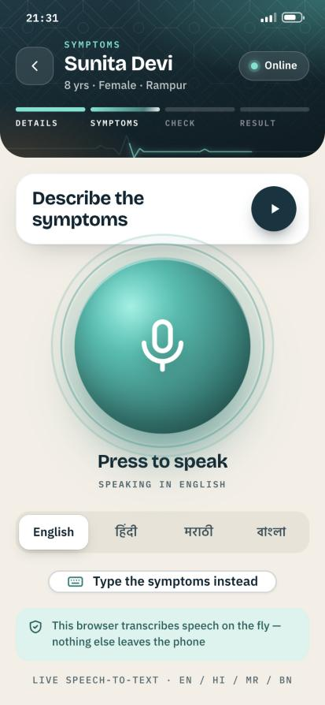<br>Voice entry | 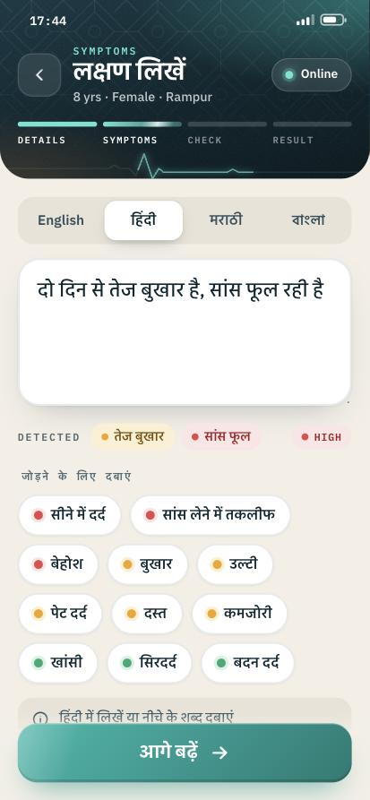<br>Typing in Hindi | 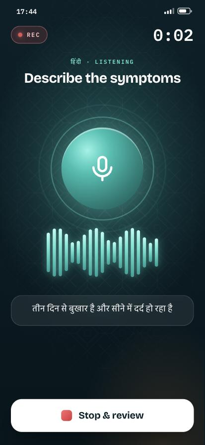<br>Listening | 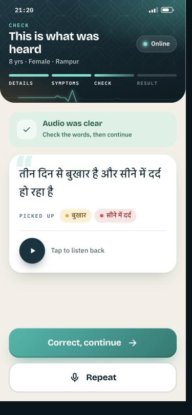<br>Confirm what was heard |
| 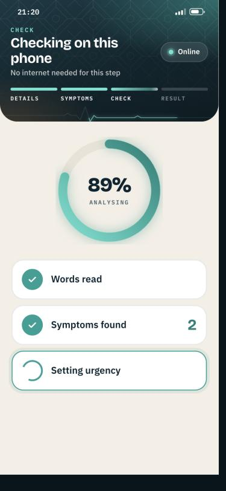<br>On-device analysis | 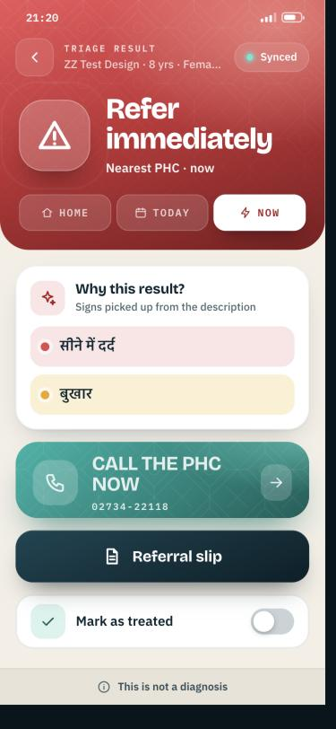<br>HIGH result with reasons | 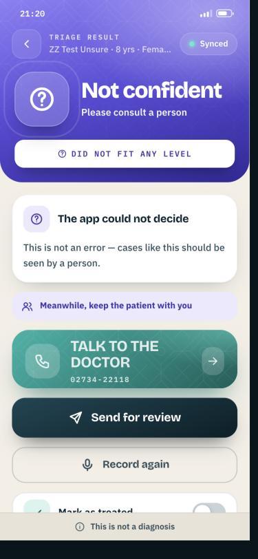<br>"Not confident" fallback | 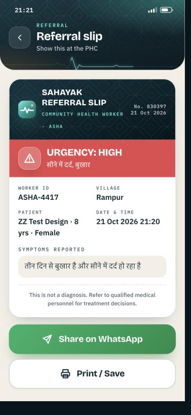<br>Referral slip |
| 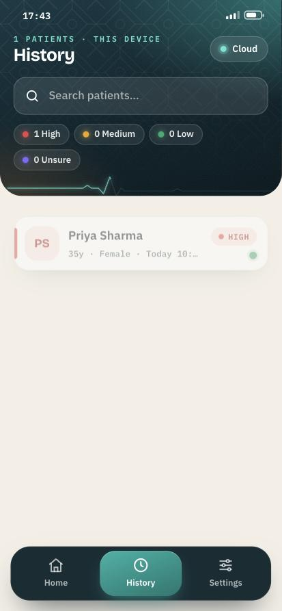<br>History | 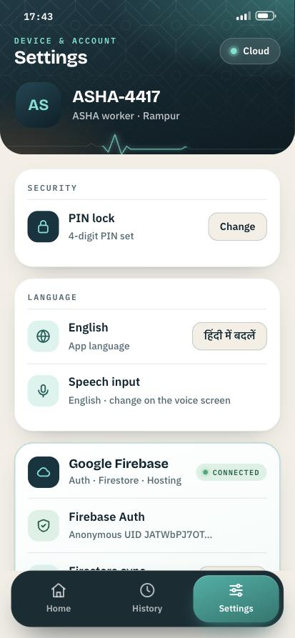<br>Settings | | |

### Doctor dashboard

| | |
|:--:|:--:|
| 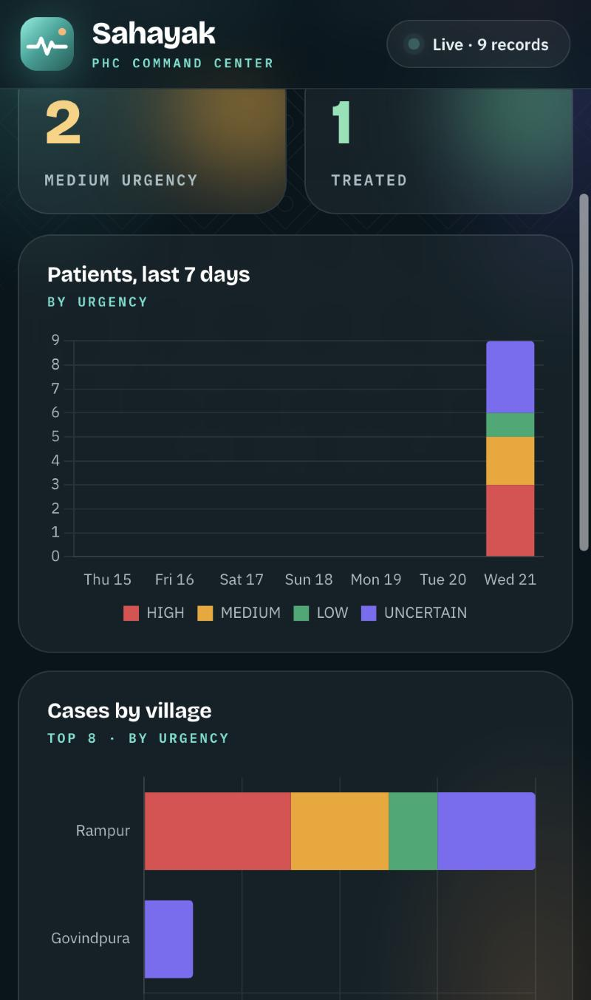<br>Live counters, charts and case table | 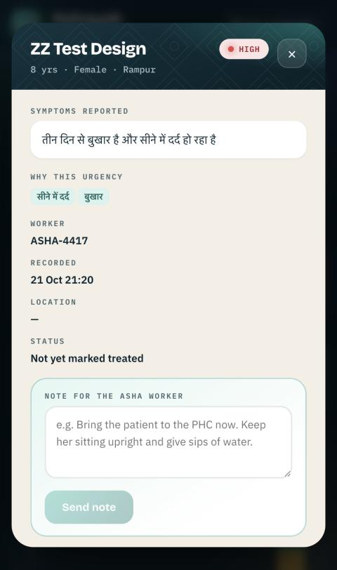<br>Case drawer with doctor note |

## Architecture

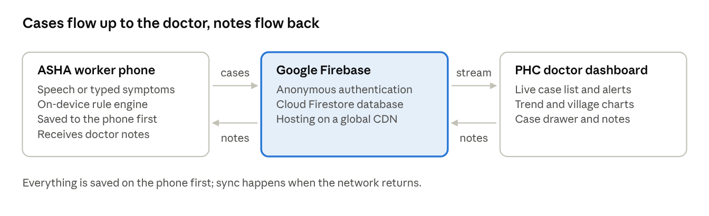

Cases flow from the phone through Cloud Firestore to the dashboard; doctor notes flow back. There is no custom server.

## How the triage works

1. **Normalise** the text (Unicode normalisation, lower-casing, invisible characters removed).
2. **Match** keywords; Latin keywords must start at a word boundary, so `ulti` does not match "multiple".
3. **Longest match wins**, so "tez bukhar" is one symptom and "blood pressure" is not bleeding.
4. **Wildcards** such as `chest ~ pain` allow up to three words in between.
5. **Severity:** any red keyword gives HIGH, otherwise any amber gives MEDIUM, otherwise any green gives LOW, otherwise "not confident".
6. **Vitals** can force HIGH (SpO2 below 94%, temperature 40 °C or more) or lift LOW to MEDIUM.

## Tech stack

HTML, CSS and vanilla JavaScript (one file per page) · Firebase Anonymous Authentication, Cloud Firestore and Hosting (compat SDK 10.7.1) · Chart.js 4.4.1 · Web Speech API · `localStorage` for offline state.

## Project layout

```
index.html         worker app (all screens, triage engine, sync)
dashboard.html     doctor dashboard
firebase.json      hosting config (/dashboard route, no-cache headers)
firestore.rules    database rules
.firebaserc        Firebase project link
docs/              screenshots and architecture image
```

## Run and deploy

Preview locally with any static server:

```bash
python3 -m http.server 8080
```

Deploy to your own Firebase project (replace the project in `.firebaserc` and the `FIREBASE_CONFIG` block in `index.html` and `dashboard.html`):

```bash
firebase deploy --only hosting,firestore:rules
```

Speech recognition works in Chrome and needs a network; typing, tap-to-add chips and triage work offline.

## Known limitations

- Triage rules are screening aids and need clinician review.
- No negation handling: "no fever" is read as fever (this over-refers rather than under-refers).
- Firestore rules let any signed-in (including anonymous) user read and write cases. This is for demonstration only; real use needs doctor and worker accounts and per-worker rules.
- Chrome sends speech audio to Google for transcription.
- Marathi and Bengali speech accuracy has not been measured on real devices.
- The keyword lists were reviewed by the authors, not by clinicians or native-speaker panels.

## About the Firebase config

The `apiKey` in the HTML files is a Firebase **web** API key. It identifies the project and is meant to be public; access is controlled by the Firestore rules above. Anyone forking this should use their own Firebase project.

## Requirement analysis and feedback

A 35-response requirement-analysis survey and a 20-response post-use feedback form informed the design and evaluation (reported in the project documents; raw responses contain email addresses and are not included here).
